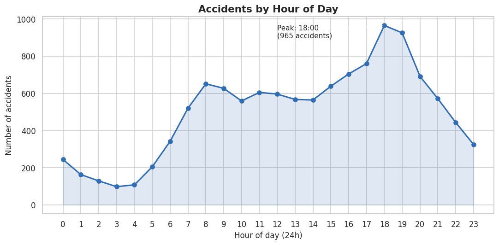
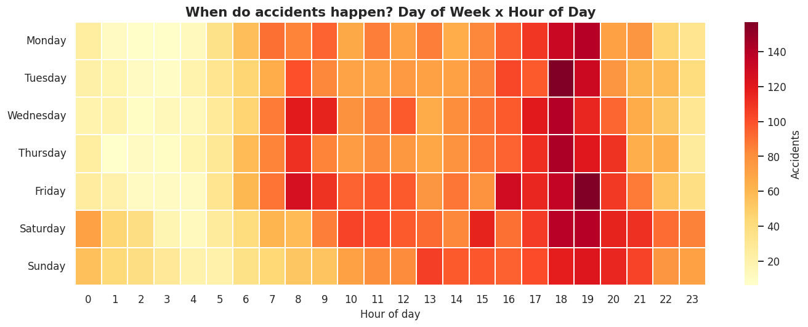
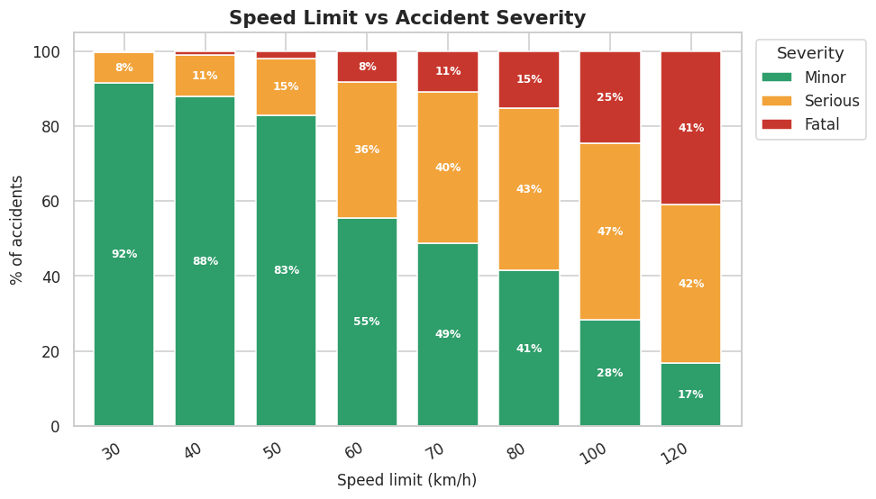
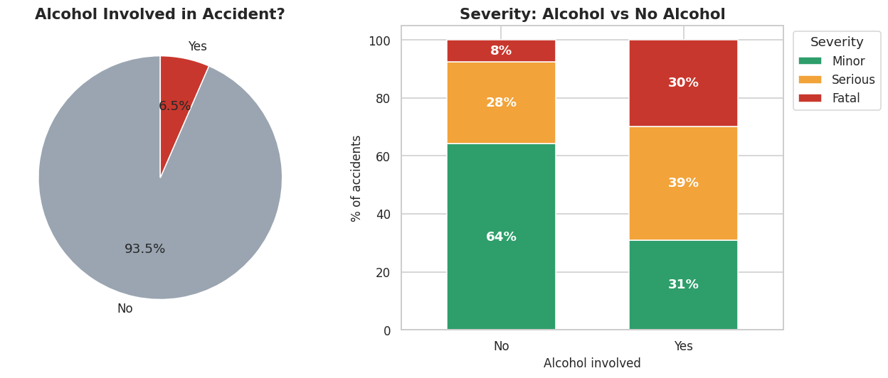
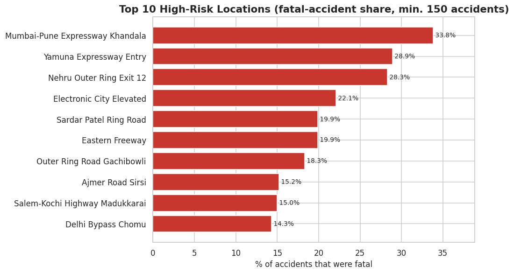
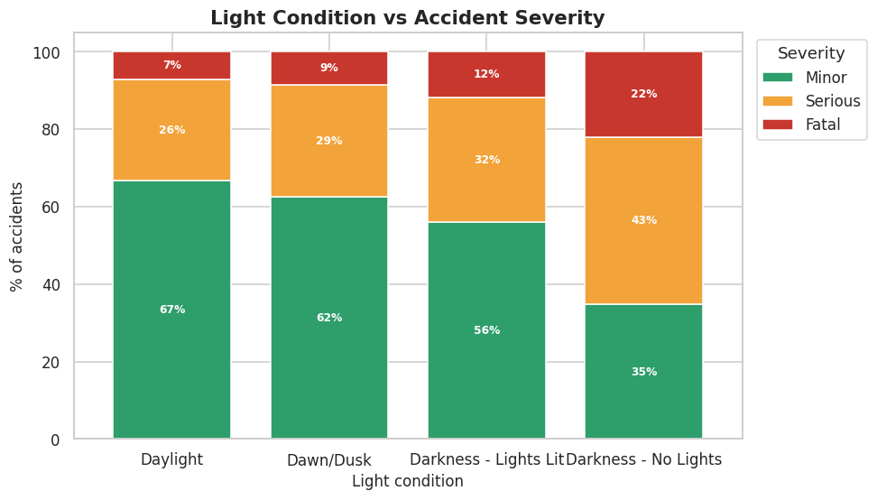

# 🚦 Smart Traffic Accident Risk Analysis & Visualization

An end-to-end **Data Analytics** project that cleans 12,000 road-accident records, finds *when, where and under what
conditions* accidents become severe or fatal, stores the data in **MySQL**, and presents the results in a
**Power BI** dashboard with evidence-based safety recommendations.

**Stack:** Python · Pandas · NumPy · Matplotlib · Seaborn · MySQL · Power BI · Excel/CSV

---

## 📌 Problem statement
Road accidents cost lives and money, but safety budgets are limited. Authorities need to know **where to act first**:
which times, locations, weather/road conditions, and vehicle types lead to the most severe outcomes - not just the most
accidents. This project turns raw accident records into those answers.

## 🎯 Objectives
1. Clean and validate a messy raw accident dataset (duplicates, missing values, typos, impossible values).
2. Explore patterns by **time, location, weather, road, vehicle, driver and alcohol involvement**.
3. Separate **frequency** (how many accidents) from **severity** (how deadly they are).
4. Build a MySQL database and answer business questions with 29 SQL queries (CTEs, window functions, joins).
5. Build a 4-page Power BI dashboard with KPIs, slicers and an insights page.
6. Convert findings into **practical, prioritised recommendations**.

## 📂 Dataset
| | |
|---|---|
| File | `data/raw/raw_accidents.csv` (raw) → `data/cleaned/cleaned_accidents.csv` (cleaned) |
| Size | 12,160 raw rows (incl. 160 duplicates) → **12,000** cleaned rows, 22 raw → 33 cleaned columns |
| Period / area | Jan 2019 – Dec 2023, 10 Indian cities (50 named locations) |
| Source | **Synthetic**, generated by `python/generate_dataset.py` (fixed random seed = reproducible) |

> **Transparency note:** the data is *synthetic but realistic*: severity is driven by speed, alcohol, weather, lighting,
> road condition, vehicle type and location; time-of-day, weekday, monsoon/fog and the 2020 lockdown dip are built in.
> Deliberate data-quality problems (missing values, typos, wrong date formats, impossible values, duplicates) are injected
> so the cleaning step is meaningful. Findings therefore describe *this dataset*, not real Indian statistics.
> The same code works on a real dataset after mapping column names.

**Real public datasets you can swap in** (check each site for current availability and licence):
* *US Accidents (Countrywide Traffic Accident Dataset)* - Kaggle (millions of records).
* *UK Road Safety Data (STATS19)* - data.gov.uk (Department for Transport; accidents, vehicles, casualties tables).
* *Road Accidents in India* - Ministry of Road Transport & Highways (MoRTH) annual reports (aggregated tables).

## 🛠 Technologies used and why
| Tool | Why it is used here |
|---|---|
| **Python / Pandas / NumPy** | Cleaning and transforming 12K rows reproducibly in code |
| **Matplotlib / Seaborn** | Static, presentation-quality EDA charts |
| **MySQL** | Central, queryable store; shows SQL skills that employers test |
| **Power BI** | Interactive dashboard with slicers for non-technical stakeholders |
| **CSV** | Simple exchange format between the stages |

## 🔄 Workflow / architecture
```
generate_dataset.py ─► raw_accidents.csv ─► data_cleaning.py ─► cleaned_accidents.csv
                                                                     │
                                  ┌──────────────────────────────────┼───────────────────────────┐
                                  ▼                                  ▼                           ▼
                       exploratory_analysis.py            MySQL (accident_analysis.sql)     Power BI (.pbix)
                       19 charts + key_insights.md        29 business queries               4-page dashboard
                                                                     └───────────────┬───────────┘
                                                                                     ▼
                                                                    Business insights & recommendations
```

## 🧹 Data cleaning (`python/data_cleaning.py`)
| Problem found | Fix | Why |
|---|---|---|
| 160 exact duplicate rows | Dropped | Would inflate every count |
| 40 spellings of 10 cities, 28 of 7 vehicle types, etc. | Standardised with mapping dictionaries | Otherwise `GROUP BY` splits one category in many |
| Dates in 2 formats (YYYY-MM-DD and DD/MM/YYYY) | Parsed each format explicitly | Never let pandas guess day/month order |
| Driver age 0, -5, 150, 999 (45 rows) + 320 missing | Set invalid to missing → median age **by vehicle type** | Median is outlier-robust; age differs by vehicle |
| Speed limit 0, 5, 400, 999 + missing | Most common limit **for the road type** | Limit is determined by road type |
| 0 vehicles (20 rows) | Set to 1 | An accident involves ≥ 1 vehicle |
| Fatalities > casualties (25 rows) | Casualties raised to equal fatalities | Casualties include fatalities |
| Missing light condition | **Derived from the hour** | Daylight/night is known from time |
| Missing weather / alcohol / gender | Labelled `Unknown` (not guessed) | Guessing "no alcohol" would understate risk |
| Extreme casualty counts (bus/truck crashes) | **Kept and flagged** (`Mass_Casualty_Flag`) | They are real, important events, not errors |

**Derived columns:** `Hour, Day, Month_Num, Weekend_Flag, Day_Type, Time_Period, Casualty_Rate, Fatality_Rate, Age_Group, Risk_Category, Mass_Casualty_Flag`.
`Risk_Category` is a transparent rule (Critical = fatal with 2+ deaths or alcohol; High = other fatal or serious with 3+ casualties; Medium = other serious; Low = minor).
A full log is written to `data/cleaned/cleaning_report.txt`.

## 📊 Exploratory Data Analysis (`python/exploratory_analysis.py`)
All 16 required analyses + 3 extras are saved in `visualizations/`.

| | |
|---|---|
|  |  |
|  |  |
|  |  |

## 🗄 SQL analysis (`sql/accident_analysis.sql`)
Creates the database and table (primary key + indexes), imports the CSV, validates the load, then runs **29 documented queries**,
each with *question → what it does → what to look for*. Features used: `GROUP BY`, `HAVING`, `CASE` pivots, `CTE`,
`JOIN`, `CROSS JOIN`, `LAG`, `RANK() OVER (PARTITION BY …)`, moving average (window frame), `WITH ROLLUP`, `NULLIF`.
Tested on MySQL 8.0.

## 📈 Power BI dashboard (`powerbi/dashboard_documentation.md`)
4 pages - **Executive Overview**, **Risk Analysis**, **Location & Vehicle Analysis**, **Insights** - with 6 synced slicers
(Year, City, Severity, Weather, Road Condition, Vehicle Type) and 25+ DAX measures. The guide gives step-by-step build
instructions and the numbers your KPI cards must match (12,000 accidents · 19,839 casualties · 1,634 fatalities).
Add your screenshots here: `visualizations/powerbi_page1.png` … 

## 🔍 Key insights (calculated from the data - full list in `docs/key_insights.md`)
* **Time:** peak volume at **17:00–19:00**; Saturday is the busiest day; late-night (12–4 AM) accidents are few but **15.6% fatal vs 6.9%** at midday.
* **Weather:** **fog (52.4% severe)** and **heavy rain (50.2%)** vs **35.1%** in clear weather.
* **Road:** wet (45.2%) and damaged roads (44.2%) are more often severe than dry roads (35.0%).
* **Vehicles:** two-wheelers = 34.3% of accidents; **trucks (14.6%) and buses (12.6%)** have the highest fatal share.
* **Locations:** the busiest spot (NH44 Singhu Border, 420) is *not* the deadliest; **Mumbai-Pune Expressway Khandala** is 33.8% fatal.
* **Alcohol:** 6.5% of accidents but **29.7% fatal vs 7.6%** (3.9× higher); alcohol share is 17.2% at night vs 4.3% by day.
* **Compounding risk:** fatal share rises from **2.3%** with no risk factor to **60%** with three or more (fog/heavy rain, unlit darkness, alcohol, limit ≥ 80).

## ✅ Business recommendations
| DATA FINDING | RECOMMENDATION |
|---|---|
| Peak accidents 5–8 PM; night accidents deadliest per accident | Deploy police and ambulances for the evening peak; separate night-time speed/drink-drive checks |
| Fog & heavy rain → ~50% severe | Weather alerts, dynamic speed limits, fog lights on affected corridors |
| Wet & pothole roads → +9–10 pts severe | Resurface potholes, improve drainage/anti-skid surfaces |
| Alcohol → 3.9× fatal share, concentrated at night/weekends | Breathalyser checkpoints on weekend nights; awareness campaigns |
| Expressway/highway hotspots have the highest fatal share | Speed cameras, lighting, median barriers and emergency points at those locations first |
| Trucks/buses most deadly; mass-casualty events are 0.11% of accidents but 6.9% of deaths | Speed limiters and fatigue rules; pre-planned multi-ambulance dispatch |

## 📁 Project structure
```
Smart-Traffic-Accident-Analysis/
├── data/
│   ├── raw/raw_accidents.csv              # generated raw data (messy on purpose)
│   └── cleaned/
│       ├── cleaned_accidents.csv          # output of data_cleaning.py (used by MySQL & Power BI)
│       └── cleaning_report.txt            # log of every fix applied
├── notebooks/accident_analysis.ipynb      # step-by-step walkthrough with outputs
├── python/
│   ├── generate_dataset.py                # creates the synthetic raw dataset
│   ├── data_cleaning.py                   # cleaning + derived columns
│   ├── exploratory_analysis.py            # charts + data-driven insights
│   └── load_to_mysql.py                   # loads cleaned CSV into MySQL (no local_infile needed)
├── sql/accident_analysis.sql              # schema, import, validation, 29 queries
├── powerbi/
│   ├── dashboard_documentation.md         # build guide, DAX, pages, slicers
│   └── accident_theme.json                # importable Power BI colour theme
├── visualizations/                        # 19 PNG charts (+ your Power BI screenshots)
├── docs/
│   ├── key_insights.md                    # generated findings + recommendations
│   └── interview_preparation.md           # pitches, Q&A, workflow explanation
├── README.md
└── requirements.txt
```

## ▶️ How to run
**Prerequisites:** Python 3.9+, MySQL 8.0+ (optional), Power BI Desktop (optional, Windows).

```bash
# 1. open a terminal in the project folder
cd Smart-Traffic-Accident-Analysis

# 2. (recommended) virtual environment
python -m venv .venv
.venv\Scripts\activate            # Windows        |   source .venv/bin/activate   (Mac/Linux)

# 3. install libraries
pip install -r requirements.txt

# 4. run the pipeline (the repo already contains the output files, so this just regenerates them)
python python/generate_dataset.py       # -> data/raw/raw_accidents.csv
python python/data_cleaning.py          # -> data/cleaned/cleaned_accidents.csv  + cleaning_report.txt
python python/exploratory_analysis.py   # -> visualizations/*.png + docs/key_insights.md

# 5. notebook (optional)
jupyter notebook notebooks/accident_analysis.ipynb
```

**MySQL (choose one):**
```bash
# Easiest: Python loader (creates database + table + loads data)
python python/load_to_mysql.py --user root --password YOUR_PASSWORD
```
or open `sql/accident_analysis.sql` in MySQL Workbench, edit the CSV path in PART 2, and run PART 1 → 2 → 3, then the queries in PART 4 one at a time.

**Power BI:** follow `powerbi/dashboard_documentation.md`.

## 🚀 Future improvements
* Replace the synthetic data with a real dataset (UK STATS19 / Kaggle US Accidents) and compare findings.
* Add latitude/longitude and a map visual with a hotspot heat-map.
* Add statistical tests (chi-square for severity vs alcohol) and a simple logistic regression to quantify risk factors.
* Schedule the pipeline (Airflow / Windows Task Scheduler) and refresh Power BI automatically.
* Build a Streamlit app that lets users filter and explore the data online.

## 👤 Author
*Your Name* · [LinkedIn](https://linkedin.com/in/your-profile) · [GitHub](https://github.com/your-username)
